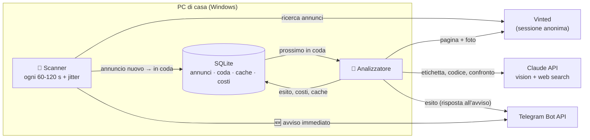
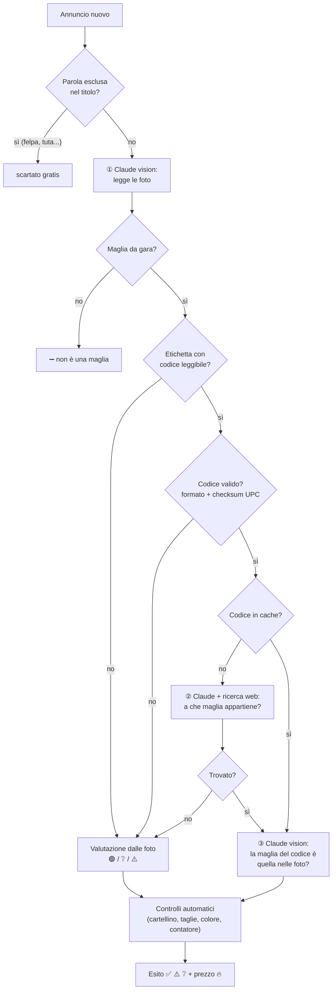

# Vinted Maglie: come funziona

Un bot che tiene d'occhio Vinted e, per ogni maglia da calcio appena pubblicata, prova a capire se è
originale **leggendo l'etichetta interna dalle foto dell'annuncio**. Gira in Python sul PC di casa,
usa Claude (vision + ricerca web) per le parti "intelligenti" e manda tutto su Telegram.

Questo documento spiega cosa fa e soprattutto **come** è costruito. Per installarlo e usarlo c'è il
[README](README.md).

---

## Il problema

Su Vinted le maglie da calcio false sono tantissime e a 20 € in foto sembrano tutte uguali.
Il controllo più affidabile che si può fare da casa è sull'**etichetta interna**: le maglie Nike,
adidas e Puma hanno un codice articolo (es. `DX2688-101`) e un codice a barre che identificano
esattamente quella maglia.

Ma c'è un tranello: **i falsi spesso hanno un codice vero**, solo che è il codice di *un'altra maglia*.
Quindi la domanda giusta non è "questo codice esiste?" ma:

> **Il codice sull'etichetta corrisponde alla maglia che si vede nelle foto?**

Un esempio reale: un annuncio di una "Inter 2023/24" bianca con l'etichetta `DM1840-452`.
Il codice esiste, ma è della **maglia home del Barcellona 2022/23**. E le ultime tre cifre
(`452`, famiglia 4xx = blu) non potrebbero mai stare su una maglia bianca.

## Cosa fa

1. **Controlla le ricerche Vinted** salvate ogni 60-120 secondi.
2. Appena esce un annuncio nuovo **manda subito un avviso** su Telegram.
3. Scarica le foto, **trova quella dell'etichetta** e ne trascrive i codici.
4. **Cerca il codice sul web** per sapere a che maglia appartiene (squadra, stagione, kit, colori).
5. **Confronta** quella maglia con le foto dell'annuncio, più una serie di controlli automatici.
6. **Risponde all'avviso** con l'esito; le maglie che passano finiscono in una lista.
7. Per quelle buone controlla anche **il prezzo**: se costa meno del solito lo segnala con 🔥.

Un esito tipico su Telegram:

```
⚠️ Codice di un'altra maglia
DM1840-452 · UPC 195867304108 · taglia L
Il codice è: Barcellona · 2022/23 · home
Le foto mostrano una maglia bianca dell'Inter, il codice è della home blaugrana del Barcellona.
✖️ il codice finisce con -452 (colore blu) ma il colore base della maglia è bianco
```

---

## Architettura

Due thread indipendenti che comunicano attraverso una coda salvata su SQLite.



- **Lo scanner** deve essere veloce e leggero: fa una richiesta per ricerca, decide cosa è davvero nuovo,
  avvisa e mette in coda. Non aspetta mai l'AI.
- **L'analizzatore** è lento (qualche decina di secondi per annuncio, tra download delle foto e chiamate
  all'API) e lavora sulla coda. Lo scanner lo "sveglia" con un `threading.Event` quando c'è qualcosa
  di nuovo, così non serve fare polling sul database.
- **La coda vive nel database**, non in memoria: se chiudo lo script o il PC si riavvia, gli annunci in
  attesa vengono ripresi e quelli già visti non vengono avvisati di nuovo.

## Il percorso di un annuncio



Ogni ramo è pensato per **spendere il meno possibile**: la prima chiamata (senza ricerche web) costa circa
un decimo di centesimo e serve a scartare presto quello che non vale la pena di verificare.

---

## Scelte tecniche

### 1. Output strutturato dall'AI, mai testo libero

Tutte e tre le chiamate a Claude usano il **tool use con uno schema JSON fisso**: il modello non risponde
in prosa, "compila un modulo". Lo schema dell'etichetta, ad esempio, ha campi come `codice_stile`, `upc`,
`colori_base` (con un `enum` di colori ammessi), `identificazione` e `originalita`, quasi tutti obbligatori.

```python
r = self._crea(
    model=self.modello, tools=[TOOL_ETICHETTA],
    tool_choice={"type": "tool", "name": "riporta_etichetta"},  # deve per forza usare il tool
    messages=[{"role": "user", "content": foto + istruzioni}],
)
```

Così non c'è parsing di testo, il codice Python lavora su dizionari con chiavi note e ogni campo ha
un tipo verificabile. Per i caratteri dell'etichetta che non si leggono bene il modello deve scrivere `?`
invece di inventarli (`CV84?3-101`): meglio un codice incompleto che uno sbagliato.

### 2. Validare prima di spendere

La ricerca web è la voce di costo principale (1 centesimo a ricerca più le pagine lette), quindi prima di
farla il codice letto passa da controlli deterministici in `maglie/codici.py`:

- **formato per marca** con espressioni regolari (Nike `CV8413-101` o `776929-100`, adidas `GM4614`,
  Puma `763432-01`), con correzione degli errori tipici (trattini "strani", trattino mancante);
- **cifra di controllo del codice a barre** (UPC-A / EAN-13): se non torna è una lettura sbagliata
  o un'etichetta falsa, e il codice a barre non viene usato;
- **cache dei risultati** per 7 giorni: lo stesso codice non viene cercato due volte. In cache finiscono
  solo i risultati completi, i "non trovato" si riprovano.

### 3. Controlli deterministici sopra il giudizio dell'AI

L'AI è brava a leggere e confrontare, ma non deve avere l'ultima parola sui segnali oggettivi.
Ci sono controlli in Python che, se falliscono, **impediscono un esito positivo** qualunque cosa dica il modello:

| Controllo | Da dove viene |
|---|---|
| Codice del cartellino ≠ codice dell'etichetta interna | guida r/KitSwap |
| Taglia diversa tra le etichette | guida r/KitSwap |
| **Colore del codice Nike incoerente con la maglia** (es. `-452` blu su una maglia bianca) | struttura dei codici Nike |
| Contatore di produzione sotto 1.000.000 (Nike/Puma) | guida r/KitSwap (indizio debole) |

Il controllo del colore è il più interessante: nei codici Nike le tre cifre finali sono il colore e la prima
indica la famiglia (`0` nero/grigio, `1` bianco, `4` blu, `6` rosso...). Il modello dice solo di che colore è
il corpo della maglia nelle foto; il confronto lo fa una funzione Python. **Non serve nessuna ricerca web**,
quindi funziona anche quando il codice non si trova online o è letto solo in parte (`DM18?0-452`).
Gli insiemi di colori ammessi sono volutamente larghi: è meglio non segnalare un caso dubbio che segnalare
un originale.

La checklist della [guida di r/KitSwap](https://www.reddit.com/r/KitSwap/wiki/spottingfakes/) è riassunta
in `maglie/guida.py` e nel prompt finisce solo la scheda della marca dell'annuncio, per tenere il prompt corto.

### 4. Le foto contano, il testo del venditore no

Un bug trovato in uso reale: una maglia originale non passava il controllo. Il venditore l'aveva chiamata
"terza maglia" ma era la quarta, e il titolo dell'annuncio finiva nella chiamata che legge le foto: il modello
si fidava del testo invece di guardare la maglia. La correzione è stata separare nettamente le due cose:

- la **lettura** descrive solo ciò che si vede, senza dedurre stagione o kit dal testo;
- nel **confronto** le foto sono la prova principale e il testo del venditore è etichettato come
  "può contenere errori". Una differenza solo nel testo non basta per un esito negativo e viene segnalata a parte (📝).

### 5. Riconoscere gli annunci davvero nuovi

Ordinare per "più recenti" su Vinted non basta: gli annunci **ripubblicati o promossi** ricompaiono in cima
anche se sono in vendita da settimane, e l'API di ricerca non espone più l'orario di pubblicazione.
Lo scanner usa tre regole:

- **primo giro** di ogni ricerca: tutto quello che c'è viene segnato come visto, senza avvisi;
- **salto di ID**: gli ID degli annunci crescono nel tempo, quindi un annuncio "nuovo" con un ID molto più basso
  dell'ultimo visto (`margine_id_vecchi`, circa un'ora di annunci) è un vecchio annuncio ripubblicato;
- **ripartenza**: se lo script è rimasto fermo più di 30 minuti, quello uscito nel frattempo viene segnato come
  visto, per non ricevere decine di avvisi tutti insieme.

### 6. Scansione "educata"

- intervallo casuale tra 60 e 120 secondi (**jitter**) e pause casuali tra una ricerca e l'altra;
- **sessione anonima**, nessun login: l'account Vinted personale non viene toccato;
- un `RLock` sul client: scanner e analizzatore non fanno mai due richieste a Vinted nello stesso momento;
- **backoff esponenziale** su 403/429: la sessione viene buttata e si aspetta 5, 10, 20, 40, fino a 60 minuti
  (±20%). Dopo 3 errori di fila arriva un 🔴 su Telegram, e un 🟢 quando Vinted torna a rispondere.

### 7. Costi sotto controllo

Ogni chiamata registra token in ingresso, in uscita e ricerche web, e calcola il costo con i prezzi del modello
(compresa la tariffa più alta oltre una certa lunghezza di prompt). Nel database c'è una riga per ogni tentativo,
**anche quelli falliti**, perché i token si pagano lo stesso. Da qui:

- un **budget giornaliero** e un numero massimo di analisi al giorno, oltre i quali gli annunci vengono saltati;
- il comando `costi` per vedere la spesa giorno per giorno;
- il **confronto di prezzo** con ricerca web parte solo per le maglie che hanno passato il controllo e,
  in modalità `occasioni`, solo se la stima gratuita della prima chiamata dice che l'annuncio costa meno della media.

Nella prima sessione di prova reale: **107 annunci analizzati in un pomeriggio, meno di 1 centesimo di dollaro
ad annuncio in media** (con Claude Haiku).

### 8. Niente moduli compilati (colpa di Windows)

Sul PC dove gira è attivo il **Controllo intelligente delle app** di Windows, che blocca le DLL non firmate.
Questo rompeva sia l'SDK ufficiale `anthropic` (dipende da `jiter` e `pydantic-core`, compilati) sia la
decompressione Brotli usata da `httpx`. Le soluzioni:

- un **client minimo per la Messages API scritto con solo `httpx`** (`ClientClaude` in `maglie/ai.py`),
  con retry ed exponential backoff sugli errori temporanei (429, 5xx, 529) e rispetto di `retry-after`;
- una piccola **patch a `vinted_scraper`** che chiede al server solo le compressioni che `httpx` sa davvero
  decodificare su quella macchina, invece di `gzip, deflate, br, zstd` fisso.

Le dipendenze di runtime sono tre: `httpx`, `vinted_scraper` e `python-dotenv`.

---

## Test

**90 test con `pytest`**, senza rete: Vinted, Claude e Telegram sono sostituiti da oggetti finti
(es. `AIFinta` restituisce letture, prodotti e verdetti preconfezionati e conta le chiamate).
Coprono tra l'altro:

- il parsing della risposta di Vinted (che nel tempo ha cambiato formato) e l'estrazione delle foto dalla pagina;
- la logica dello scanner: baseline, annunci vecchi per salto di ID, parole escluse, backoff;
- la validazione dei codici e del checksum UPC;
- tutti i rami dell'analisi, compresi i casi in cui un controllo automatico deve bloccare un esito positivo
  (il caso `DM1840-452` su una maglia bianca è un test);
- il calcolo dei costi e il confronto di prezzo.

```bash
pip install -r requirements-dev.txt
pytest
```

## Stack

- **Python 3.11+** (`tomllib` per la configurazione), `threading` per i due processi
- **SQLite** in modalità WAL, una connessione per thread
- **Claude API** (Messages API via `httpx`): vision, tool use con schema JSON, web search
- **vinted_scraper** per la sessione e la ricerca su Vinted
- **Telegram Bot API** (via `httpx`): avviso immediato e risposta in thread con l'esito
- **pytest**

## Struttura del codice

```
main.py              CLI: avvia, prova-ricerca, prova-annuncio, lista, costi, telegram-*
maglie/servizio.py   Scanner e Analizzatore (thread), jitter, backoff, budget
maglie/vinted.py     tutto ciò che tocca Vinted: ricerca, pagina annuncio, foto
maglie/analisi.py    il flusso di un annuncio, i controlli automatici, i messaggi Telegram
maglie/ai.py         client Claude su httpx, schemi dei tool, le chiamate (etichetta, codice, prezzi, confronto)
maglie/codici.py     validazione dei codici, checksum UPC/EAN, colore dei codici Nike
maglie/guida.py      checklist anti-falsi per marca (dalla guida r/KitSwap)
maglie/db.py         SQLite: annunci, coda, cache, consumi
maglie/telegram.py   Bot API
maglie/config.py     config.toml + .env
tests/               test con Vinted, Claude e Telegram finti
```

Le scelte di organizzazione seguono una regola semplice: **tutto quello che dipende da un servizio esterno sta in
un file solo**. Se Vinted cambia la risposta della ricerca, si tocca solo `vinted.py`; se cambia l'API di Claude,
solo `ai.py`.

## Limiti

- **"Etichetta OK" non vuol dire "originale"**: vuol dire che il codice è coerente con la maglia. Un falso fatto
  bene, con il codice giusto, può passare. È un filtro per scegliere cosa guardare con attenzione, non una perizia.
- Senza la foto dell'etichetta la valutazione si basa solo sull'aspetto, e con foto piccole un buon falso può passare.
- Il controllo del colore vale solo per Nike: adidas e Puma non hanno una codifica dei colori fissa.
- Lo scraping va contro i termini di servizio di Vinted: il progetto è a uso personale, con intervalli lunghi
  e una sola richiesta alla volta.
